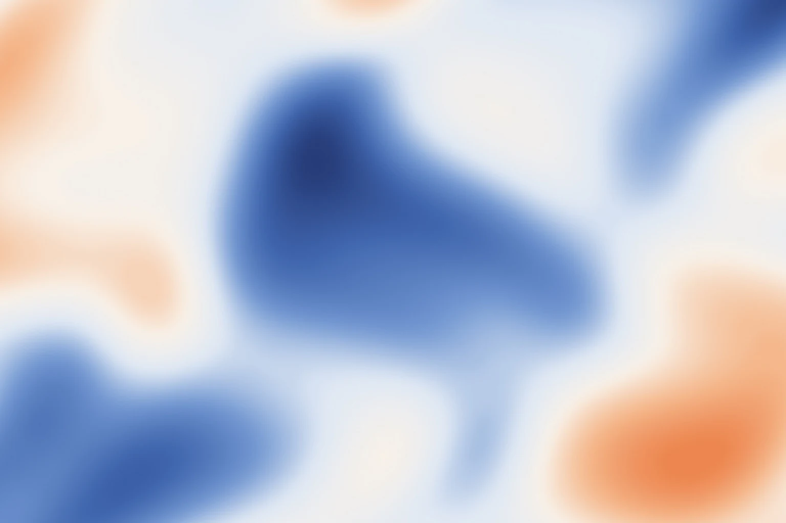

# GenAI Mesh Gradient

**A research-informed agent skill for controllable visual generation.**

Translate a visual brief into a clear recipe, generate mesh-gradient artwork,
and refine it through feedback. The skill combines palette and composition
guidance with editable Figma construction, layered SVG alternatives and output
inspection. Use it for presentation covers, website heroes, thumbnails and
consistent brand visuals.

[Research connection](#research-connection) · [Install and use](#install-and-use) ·
[For agents](#for-agents) · [Illustrated guide](index.html) · [中文简要说明](#中文简要说明)

## Samples

Six native Figma studies, each **1536×1024 (3:2)**, share a blue, apricot and warm-white
palette. The WebP images are flattened full-size previews; the recipes and builder describe
their editable construction. These are the existing October 24 studies.

| Sky-inspired | Dreamlike |
|---|---|
|  |  |
| Flower-inspired | Diffuse |
|  |  |
| Heightmap | Multipoint |
|  |  |

| Study | Native construction | Reference settings |
|---|---|---|
| Sky-inspired | Broad diagonal current; 3 curved planes + 2 light fields | 125–155 px blur |
| Dreamlike | Unequal offset light and shadow; 2 planes + 4 fields | 120–165 px blur |
| Flower-inspired | Magnified cropped petals; 4 translucent planes + 2 reflections | Plane opacity 56–85%; blur 125–160 px |
| Diffuse | 1 curve + 3 broad radial fields | 155–185 px blur |
| Heightmap | Warped field with peaks, valleys and saddles; marching-squares contours | 40 levels; blur 24–38 px |
| Multipoint | 11 Gaussian alpha-mask groups with separate color fills | No extra layer blur |

[Full recipes and controls](references/figma-recipes.md) ·
[Six-study builder](scripts/blue_orange_studies.js) ·
[Required native helper](scripts/figma_native.js)

The builder runs inside a connected Figma execution tool. Heightmap exposes
`detail`, `warp`, `levels`, `blurMin` and `blurMax`; valid ranges and examples
are in the recipes. The guide also compares the same Sky at 100/150/200 px blur.

Four browser palette studies keep the same composition and change only color
roles. Exact colors, layer order and fade stops are in the
[palette/layout recipes](references/palettes-and-layout.md).

| Monochromatic | Analogous warm |
|---|---|
|  |  |
| Apricot/cobalt | Neutral/accent |
|  |  |

## Research connection

Generative interface research asks how outputs can respond to user input,
design rules and feedback. This skill applies those ideas at the workflow level:
it converts an open-ended brief into an explicit recipe that an agent can
execute, inspect and revise.

For example, “make it softer and leave room for a title” becomes a protected
text area, color roles, region positions, opacity and edge-softness settings.
The agent selects a rendering route and adjusts the parameter responsible for
the visible mismatch. The package's practical contribution is this reusable
workflow, its editable construction recipes and its rendering helpers.

| Research idea | Application in the skill | Inspectable implementation |
|---|---|---|
| User input as a generation condition | Specify purpose, palette, reference structure, size and editability | [Recipe and route selection](SKILL.md) |
| Design knowledge as a constraint | Protect content areas; control color roles, composition and scale | [Art direction](references/art-direction.md) and [Figma recipes](references/figma-recipes.md) |
| Feedback during refinement | Inspect actual output; adjust a relevant parameter; hold composition fixed for palette comparison | [Diagnosis workflow](SKILL.md#diagnose-instead-of-adding-more-blur) and [interactive guide](index.html#direction) |
| Usable output beyond a preview | Preserve separate color/mask groups and expose node IDs for later edits | [Native helper](scripts/figma_native.js) and [study builder](scripts/blue_orange_studies.js) |

Related research:

- [*Automated UI Interface Generation via Diffusion Models: Enhancing Personalization and Efficiency*](https://arxiv.org/abs/2503.20229)
  (2025; public preprint submitted March 26). Discusses conditional inputs,
  design optimization and feedback in UI generation.
- [*Generative Modeling of Human-Computer Interfaces with Diffusion Processes and Conditional Control*](https://arxiv.org/abs/2601.06823)
  (2026; public preprint submitted January 11). Discusses user intent, context
  and task constraints in conditional interface generation.

The connection is between research ideas and the design workflow. The repository
contains agent instructions and procedural Figma/SVG helpers, rather than the
papers' trained diffusion models, weights or experimental reproduction. An
external image-generation tool can be used for model-generated material; its
output is usually pixels. The papers' results do not measure this package.
Independent adoption, productivity gains and business outcomes have not been
established for the skill.

## Install and use

Install the complete folder, including `SKILL.md`, `references/`, `scripts/`
and `design/`. For Codex, a typical installation is:

```sh
git clone https://github.com/9929y/genai-mesh-gradient.git \
  ~/.codex/skills/genai-mesh-gradient
```

Reload the client's skill list if needed. Other agents have their own loading
conventions. Installing the files alone does not enable automatic invocation in
every client or establish a Figma connection.

1. Provide the use case, size/aspect ratio, a reference or brand colors, the area
   reserved for content, and the required output format and editability.
2. If colors are undecided, compare a few palettes on the same composition before
   producing a larger set.
3. For native Figma output, connect a tool that can write to the canvas and specify
   the target file. The agent must check the connection's actual capabilities.
4. Review the result in its intended slide or page. Refine palette, distribution,
   fusion and contrast while preserving the chosen composition during color comparison.

Example request:

> Use $genai-mesh-gradient to create a 16:9 presentation-cover gradient.
> Compare monochromatic, analogous and restrained contrasting palettes using
> the same composition. Keep the left third quiet for a dark title. After I
> choose a direction, build editable layers in my Figma file, inspect the result,
> and explain how to change its colors and softness.

Previously published as **Mesh Gradient Generation** (`mesh-gradient-generation`).
For an existing installation, rename its folder to `genai-mesh-gradient`, update
its contents and saved prompts, then reload the client. The package supplies no
automatic alias for the old invocation.

## For agents

When working in the repository, read [AGENTS.md](AGENTS.md), then
[SKILL.md](SKILL.md). A skill loader normally loads `SKILL.md` directly.
Read only the references required for the task:

| Task | Read next |
|---|---|
| Choose use case, palette, brand direction or editing controls | [Art direction](references/art-direction.md) |
| Adapt sample colors, aspect ratio or blur | [Palette/layout recipes](references/palettes-and-layout.md) |
| Build the six native effects or reconstruct a reference | [Figma recipes](references/figma-recipes.md) |
| Operate Figma, export SVG or select another renderer | [Tool adapters](references/adapters.md) and the connector's current instructions |
| Explore fluid, pigment, oil/brush or silhouette rendering | [Related effects](references/effects.md) |
| Add ambient motion or source-image reveal | [Motion guidance](references/motion.md) |

Inspect the target tool and existing artwork before editing. Return the artifact
or node link, adjustable controls, verification results and relevant limits.
Repository instructions do not authorize changes to unrelated files.

### Included helpers and editing limits

- `scripts/figma_native.js`: `buildMesh(figma, spec)` creates isolated native
  Gaussian-mask groups with separate color fills and returns their node IDs.
  Inline it into a supported Figma execution tool; it is not a standalone plugin.
- `scripts/blue_orange_studies.js`: rebuilds the six native studies after
  `figma_native.js` is inlined. Supply a clear x/y position; optional `keys`
  selects studies and `heightmap` controls detail, warp, levels and blur.
  The builder was executed and visually inspected in live Figma. Its paths use
  a 3:2 composition; recompose when changing the aspect ratio.
- `scripts/render_svg.py`: a Python 3 standard-library generator for four
  original schematic families. It does not segment an input image or reproduce
  every advanced effect.

  ```sh
  python3 scripts/render_svg.py --effect atmospheric --seed 17 \
    --width 1200 --height 800 --output study.svg
  ```

- `scripts/palette_studies.js`: four palette previews and three recomposed
  layouts. `layoutSpec` converts short-side support radii to the native helper's
  per-axis units. Browser-layout parity with live Figma remains unverified.
- `index.html`: the single illustrated guide, with English explanations and
  short Chinese notes, real Figma samples, the Sky blur comparison, palette
  controls and 16:9 / 1:1 / 9:16 layout studies. Download the **whole repository**
  and open it locally. Its controls do not sync edits to Figma.

Native layers, imported SVG and flattened images have different editing limits.
The package does not include automatic PPT creation, image segmentation or a
complete shader/reveal engine. For broad light fields, compare 100/150/200 px
at 1536×1024; Flower uses 125–160 px and 56–85% plane opacity, while Heightmap
uses 24–38 px across 40 levels. Scale the chosen radius with the short side.
Gaussian-mask masses use no extra layer blur by default. Recompose for a new
aspect ratio. The legacy SVG `petal` sketch is not the Flower visual target.

Recipes draw on inspected native artwork and recovered construction records.
The six-study builder and mask helper have been run in Figma; browser layouts
still need target calibration. See the guide for verification scope.

## 中文简要说明

这份 Skill 帮助 AI Agent 把用途、配色、构图和修改要求写成具体配方，再生成可编辑的
Figma 图层或 SVG。适合 PPT 封面、网页主视觉、缩略图和品牌视觉。

方法与生成式界面研究中的“条件输入、设计约束、反馈修改”相连。当前实现是 Agent
指令与图形脚本；论文模型和实验结果不属于本包的实现或成绩。

安装时保留完整目录，用 `$genai-mesh-gradient` 调用。说明画幅、品牌色、文字位置和
可编辑要求；需要 Figma 原生图层时，先接通支持画布写入的工具。MCP 在这里是 Agent
读取和操作 Figma 的连接通道，安装 Skill 本身不会建立连接。

先固定构图比较配色，选定后再调整融合、对比与细节。六类样例、参数及操作说明见
[同一份图解页](index.html)。原生图层、SVG 与位图的可编辑程度不同，交付前应核对。

## License

[MIT](LICENSE). Independent community project; not affiliated with Figma or an
image-generation provider.
